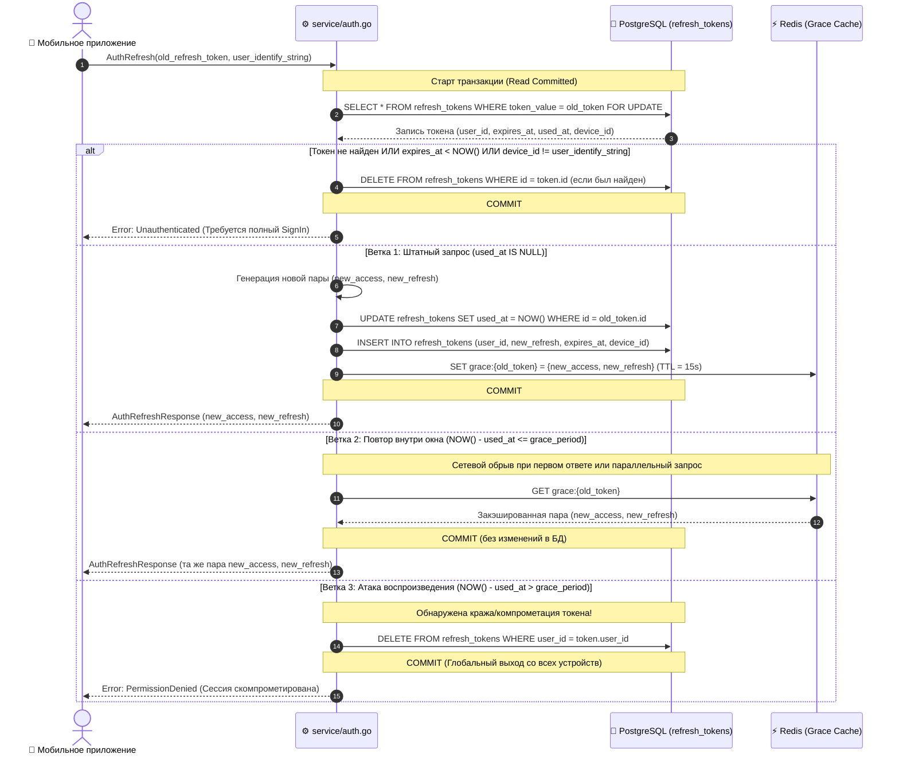

## 4. Sequence Diagram: Ротация токенов и логика `grace_period`

Диаграмма показывает пошаговое взаимодействие между мобильным приложением, `service/auth.go`, PostgreSQL и Redis при вызове `AuthRefresh` (включая защиту от гонки запросов через блокировку строки `FOR UPDATE`).

### Ключевые архитектурные детали этой схемы:

* **Зачем нужен `FOR UPDATE` на шаге 2?** Если приложение отправит два одинаковых запроса на рефреш одновременно (с разницей в 1 миллисекунду), второй запрос встанет в очередь на уровне строки в PostgreSQL, дождется завершения первой транзакции, увидит уже заполненный `used_at` и пойдет по **Ветке 2** (из Redis), вместо того чтобы сгенерировать две конкурирующие пары токенов.
* **Зачем кэшировать ответ в Redis (`grace:{old_token}`)?** В таблице `refresh_tokens` хранится только `refresh_token`, а `access_token` (JWT) в БД не сохраняется. Кэш в Redis на 10–15 секунд позволяет при сетевом сбое отдать клиенту **ровно ту же пару** (`new_access` + `new_refresh`), не создавая лишних записей в PostgreSQL.
* **Фоновая очистка (Cleanup):** Так как использованные токены остаются в БД для проверки `used_at`, раз в сутки (через `pg_cron` или воркер в Go) нужно удалять старые записи: `DELETE FROM refresh_tokens WHERE expires_at < NOW() OR used_at < NOW() - INTERVAL '1 day'`.
