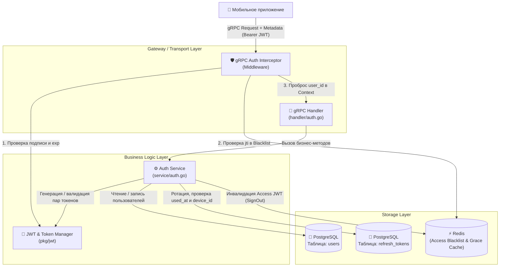

# Архитектура цикла авторизации (gRPC + JWT + PostgreSQL + Redis)

Документ описывает полный жизненный цикл аутентификации, авторизации запросов и ротации токенов для сервиса каршеринга на базе gRPC-контракта `AuthService` и схемы БД (`users`, `refresh_tokens`).

---

## 1. Схема взаимодействия компонентов

---

## 2. Описание узлов системы и их ответственности

### 1. Мобильное приложение (Client)
* Хранит пару токенов: короткоживущий `access_token` (JWT, например, 15 минут) и долгоживущий `refresh_token` (UUID, например, 30 дней).
* Формирует и передает уникальный идентификатор устройства (`user_identify_string` / Device ID) во всех методах `AuthService` для привязки сессии к конкретному телефону.
* При получении gRPC-ошибки `Unauthenticated` (истек `access_token`) автоматически ставит текущие запросы на паузу и вызывает `AuthRefresh`.

### 2. Узел `Interceptor` (gRPC Unary/Stream Interceptor)
Перехватывает все входящие gRPC-запросы до попадания в бизнес-логику.
* **Маршрутизация публичных методов:** Пропускает без проверки токена методы регистрации, входа и обновления (`SignUp`, `SignIn`, `AuthRefresh`).
* **Валидация заголовка:** Извлекает `access_token` из `metadata` запроса (`authorization: Bearer <token>`).
* **Криптографическая проверка:** Обращается к `Token Manager` для проверки подписи JWT и срока жизни (`exp`).
* **Проверка отзыва (Blacklist):** Проверяет наличие уникального идентификатора токена (`jti`) в `Redis`. Если токен найден в черном списке (пользователь нажал `SignOut`, но 15 минут жизни JWT еще не вышли) — отклоняет запрос со статусом `Unauthenticated`.
* **Обогащение контекста:** Извлекает `user_id` из payload токена и кладет его в `context.Context` для передачи дальше в `Handler`.

### 3. Узел `Handler` (`handler/auth.go`)
Тонкий транспортный слой, реализующий интерфейс `AuthServiceServer` из `.proto`.
* Проводит первичную валидацию входящих protobuf-сообщений (проверка на пустые строки логина, пароля, `user_identify_string`).
* Маппит gRPC-запросы в внутренние DTO-модели приложения и передает управление в `service/auth.go`.
* Преобразует внутренние доменные ошибки (например, *«пользователь уже существует»*, *«токен скомпрометирован»*) в стандартные gRPC-статусы (`AlreadyExists`, `PermissionDenied`, `Unauthenticated`).

### 4. Узел `Service` (`service/auth.go`)
Ядро бизнес-логики авторизации. Управляет транзакциями, безопасностью сессий и связью между БД и генератором токенов.
* **При `SignUp`:** Хеширует пароль (bcrypt), сохраняет запись в `users`, инициирует создание первой сессии в `refresh_tokens`.
* **При `SignIn`:** Ищет пользователя в `users`, сверяет `password_hash`, закрывает/перезаписывает старую сессию для данного `user_identify_string` и выпускает новую пару токенов.
* **При `AuthRefresh`:** Реализует **Refresh Token Rotation** и защиту от повторного использования (Replay Attack) с учетом `grace_period` (подробно в разделе 3).
* **При `SignOut`:** Помечает/удаляет refresh-токен для конкретного устройства (`user_identify`) в PostgreSQL и отправляет текущий `access_token` (`jti`) в черный список `Redis` на остаток его времени жизни (TTL).

### 5. Узел `Token Manager` (`pkg/jwt`)
Изолированный модуль работы с криптографией.
* Генерирует `access_token` (JWT с claims: `sub` = `user_id`, `jti` = UUID токена, `dev` = `user_identify_string`, `exp`, `iat`).
* Генерирует криптостойкий случайный UUID для `refresh_token`.

### 6. Хранилища данных
* **PostgreSQL (`users`):** Хранит учетные данные пользователей (`login`, `password_hash`).
* **PostgreSQL (`refresh_tokens`):** Хранит активные и недавно использованные сессии устройств. Поле `user_identify_string` позволяет поддерживать мультисессионность (пользователь может быть одновременно залогинен с телефона и планшета, и выход на одном устройстве не выбросит его на другом).
* **Redis:** Быстрое in-memory хранилище с автоматическим удалением ключей по TTL. Используется для:
  1. Черного списка отозванных `access_token` (`blacklist:<jti>`).
  2. Кэширования ответа при срабатывании `grace_period` (опционально, чтобы при параллельных запросах отдать клиенту ту же самую новую пару токенов).

---

## 3. Сценарии работы (Полный цикл)

### Сценарий А: Регистрация (`SignUp`) и Вход (`SignIn`)
1. Клиент отправляет `user_name`, пароль и `user_identify_string`.
2. `Handler` валидирует входные данные и передает их в `service/auth.go`.
3. `Service` проверяет уникальность `login` (при `SignUp`) или сверяет `bcrypt`-хеш пароля (при `SignIn`) в таблице `users`.
4. `Service` запрашивает у `Token Manager` новую пару: `access_token` (JWT) + `refresh_token` (UUID).
5. В рамках транзакции в `refresh_tokens` сохраняется запись: `user_id`, `token_value`, `expires_at`, `user_identify_string`, `used_at = NULL`. Если для этого `user_identify_string` уже была старая запись — она удаляется или инвалидируется.
6. Клиент получает `success = true` и оба токена.

### Сценарий Б: Авторизованный запрос к API (например, бронирование авто)
1. Клиент отправляет запрос с заголовком `Authorization: Bearer <access_token>`.
2. `Interceptor` проверяет валидность подписи JWT и срок `exp`.
3. `Interceptor` делает быстрый запрос в `Redis`: нет ли `jti` этого токена в черном списке.
4. Если всё чисто — `Interceptor` извлекает `user_id` из токена и передает запрос в целевой сервис каршеринга.

### Сценарий В: Обновление токенов (`AuthRefresh`) и логика `grace_period`
Мобильные сети нестабильны: клиент может отправить запрос на рефреш, сервер обновит токен, но ответ потеряется по пути из-за обрыва связи. Приложение повторит запрос со старым `refresh_token`. Чтобы не разлогинивать честного пользователя, используется **`grace_period`** (например, 10–15 секунд) и поле `used_at` в БД:

1. Клиент передает старый `refresh_token` и `user_identify_string`.
2. `Service` находит запись в `refresh_tokens` по `token_value` (желательно с блокировкой строки `FOR UPDATE` для защиты от гонки параллельных потоков).
3. **Проверка 1 (Валидность):** Если токен не найден или `expires_at < NOW()` — отказ (`Unauthenticated`).
4. **Проверка 2 (Привязка к устройству):** Если `user_identify_string` из запроса не совпадает с сохраненным в БД — тревога (токен украден и используется с другого устройства). Токен удаляется, возвращается отказ.
5. **Проверка 3 (Анализ `used_at` и `grace_period`):**
   * **Случай 3.1 (`used_at IS NULL`):** Токен используется впервые (штатная ситуация). `Service` ставит текущему токену `used_at = NOW()`, генерирует **новую** пару `access + refresh`, сохраняет новый `refresh_token` в БД и возвращает её клиенту.
   * **Случай 3.2 (`used_at IS NOT NULL`, но `NOW() - used_at <= grace_period`):** Повторный запрос в рамках льготного окна (сетевой сбой или два параллельных запроса от одного клиента). `Service` **не** считает это атакой и отдает уже выпущенную актуальную пару токенов для этого устройства (из кэша Redis или из актуальной записи в `refresh_tokens`).
   * **Случай 3.3 (`used_at IS NOT NULL` и `NOW() - used_at > grace_period`):** Обнаружена **атака повторного воспроизведения (Token Reuse / Theft)** — кто-то пытается воспользоваться старым токеном спустя минуты/часы после его замены. `Service` запускает протокол защиты: удаляет **все** `refresh_tokens` данного `user_id` из БД (принудительный выход на всех устройствах) и возвращает ошибку компрометации.

### Сценарий Г: Выход из системы (`SignOut`)
1. Клиент вызывает `SignOut`, передавая `user_identify` в теле запроса и текущий `access_token` в метаданных.
2. `Interceptor` проверяет `access_token` и передает `user_id` и `jti` (плюс время до истечения токена `remaining_ttl`) в контекст.
3. `Service` удаляет запись из таблицы `refresh_tokens` по связке `user_id + user_identify_string` (сессия этого устройства закрыта навсегда).
4. `Service` записывает `jti` текущего `access_token` в черный список `Redis` с временем жизни `remaining_ttl`. С этой секунды даже формально неистекший JWT перестает приниматься `Interceptor`-ом.
